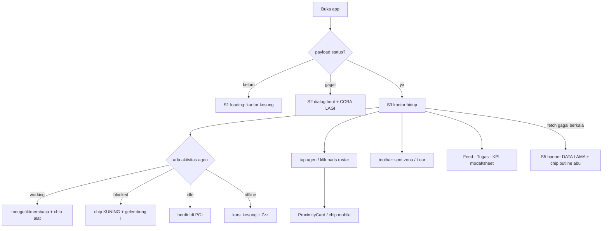

# Kantor 2D Pixel-Art — Spec UI/UX

> Pengganti scene 3D (three.js) di `frontend/src/components/Scene.tsx`.
> Panel yang ada (Hud, Roster, Feed, TaskBoard, KPI, ProximityCard, DPad) **di-restyle**
> ke gaya pixel — fungsi, data, dan teksnya tetap seperti sekarang.
> Wireframe statis: `docs/design/office-2d/wireframe.html` (buka langsung di browser).
>
> Gaya: top-down/2.5D di atas grid tile **persegi** (bukan isometrik diamond), framing
> "cutaway diorama", pixel 16-bit (nearest-neighbor, palet terbatas, shading 2–3 tone).
> Referensi gaya: my-virtual-office (meja+monitor menunjukkan kerja nyata, chip di atas
> kepala, paper airplane, offline abu + "Zzz") dan pixel-agents (jalan → duduk → mengetik/
> membaca, flag visual saat stuck). **Tiru gayanya, jangan salin asetnya** — semua sprite
> di sini orisinal.

---

## 1. Personas & tugas utama

| Persona | Tugas utama |
|---|---|
| Bos (lewat Telegram/browser) | Sekilas melihat: siapa kerja, siapa macet, siapa tidur. Klik agen → baca detailnya. |
| Ndoro Kakung / lead | Memastikan delegasi sampai: melihat paper airplane antar-meja dan chip kuning. |
| Pengembang internal | Cek feed/taskboard/KPI tanpa meninggalkan konteks kantor. |

**Satuan makna visual:** satu meja = satu agen; apa yang terjadi di monitornya = alat yang
sedang dia pakai. Kantor harus terbaca tanpa membuka panel apa pun.

---

## 2. Design tokens

### 2.1 Palet inti — terakota hangat + navy kontras tinggi

Setiap warna keluarga punya **2–3 tone** (dasar / terang / gelap) untuk shading 16-bit.
Tidak ada gradien halus, tidak ada blur: bayangan = blok warna solid berikutnya.

| Token | Hex | Peran |
|---|---|---|
| `--px-navy-900` | `#101828` | Dinding, outline sprite, nameplate, plate chip in-world |
| `--px-navy-800` | `#182238` | Surface panel UI (sidebar, toolbar, modal) |
| `--px-navy-700` | `#24304A` | Panel naik (hover, kolom, kartu) |
| `--px-navy-600` | `#33415F` | Garis/border panel, track bar |
| `--px-terra-600` | `#8F4520` | Tone gelap terakota: front panel meja, bayangan furnitur |
| `--px-terra-500` | `#C4602C` | Terakota dasar: lantai Pendopo tile A, sofa |
| `--px-terra-400` | `#E07B3E` | Terakota terang: tile B, aksen aktif, brand mark |
| `--px-terra-300` | `#F0A268` | Highlight 1px tepi atas furnitur |
| `--px-sand-500` | `#C2A176` | Kayu gelap: garis plank Dev, bayangan desktop |
| `--px-sand-400` | `#D9B98C` | Desktop meja (permukaan terang) |
| `--px-sand-300` | `#E8CFA8` | Lantai pasir: tepi Pendopo, lesehan Edu |
| `--px-sand-200` | `#F2E2C4` | Gelembung bicara krem, highlight desktop |
| `--px-ink` | `#F4E9D6` | Teks utama on navy — **13.2:1** vs `--px-navy-800` |
| `--px-ink-dim` | `#C9CFDD` | Teks sekunder — **10.2:1** |
| `--px-muted` | `#93A0BC` | Label, caption, time — **6.0:1** |
| `--px-line` | `#33415F` | Border panel (sama dengan navy-600) |

### 2.2 Warna status (dipakai dot, chip, rail — konsisten kanvas ↔ panel)

| Status | Hex | Kontras vs navy-800 | Bentuk non-warna (WCAG 1.4.1) |
|---|---|---|---|
| `working` | `#F2B434` | 8.6:1 | dot penuh + chip nama alat + tangan mengetik |
| `reviewing` | `#A98CE0` | 5.7:1 | dot penuh + chip "review" + kaca pembesar di monitor |
| `idle` | `#6FB1E8` | 6.9:1 | dot cekung (ring) + agen berdiri/santai, monitor padam |
| `blocked` | `#FFC93B` | 11.6:1 (plate) | **chip KUNING** "butuh izin" + gelembung "!" + geming kepala |
| `offline` | `#8B93A5` | 5.1:1 | kursi KOSONG abu + "Zzz", monitor mati total |
| `ok` | `#7FC08C` | 7.4:1 | gateway sehat, LED rak server |
| `danger` | `#E2705F` | — | run failed, arrow komunikasi gagal |

Chip blocked: latar `#FFC93B`, teks `#1A1208` (**12.1:1**). Tidak ada status yang hanya
dibedakan oleh warna — selalu ada bentuk/ikon/teks pendamping.

### 2.3 Layar monitor & detail in-world

| Token | Hex | Peran |
|---|---|---|
| `--px-screen-bg` | `#14201A` | Latar terminal/editor (hijau tua kehitaman) |
| `--px-screen-green` | `#9CE8A8` | Teks terminal (11.6:1 di atas screen-bg) |
| `--px-screen-blue` | `#8FB8E8` | Address bar / jendela browser |
| `--px-screen-paper` | `#EFE4CC` | Dokumen/modul (mode baca) |
| `--px-bubble-ink` | `#241812` | Teks "..." dan "!" di gelembung krem (14.3:1) |

### 2.4 Tipografi — pasangan pixel + sans

| Layer | Font | Ukuran | Ketentuan |
|---|---|---|---|
| Label in-world (nameplate, chip, papan zona) | `Pixelify Sans` (OFL, self-host di `frontend/public/fonts/`), fallback `Silkscreen`, `monospace` | 8 / 10 / 12 px, UPPERCASE, `letter-spacing: 0.08em` | digambar pada kelipatan 1 px sprite; **tanpa anti-aliasing** (`image-rendering: pixelated` untuk canvas; teks DOM pixel font boleh AA tapi ukuran ganjar bilangan bulat) |
| Judul panel (Hud brand, panel-head) | sama, 10–12 px | | satu-satunya tempat font pixel di DOM |
| Teks panel (roster, feed, taskboard, KPI, card) | stack sans eksisting: `ui-sans-serif, system-ui, -apple-system, 'Segoe UI', Roboto` | 10–13 px, `font-variant-numeric: tabular-nums` untuk angka | **jangan** pakai font pixel untuk isi panjang — keterbacaan |

Alasan: font pixel untuk identitas/label singkat (nuansa 16-bit), sans bersih untuk data —
persis pemisahan referensi (judul Press Start 2P, teks Inter) tanpa menyalin fontnya.

### 2.5 Grid tile & dimensi sprite

- **1 unit dunia (≈1 m, lihat `lib/rooms.ts` FLOOR 28×20) = 1 tile = 32 px** pada zoom 1×.
- Kanvas dunia: 28 × 20 tile = **896 × 640 px** dasar.
- Level zoom **bilangan bulat saja**: 0.5× (16 px/tile), 1× (32), 2× (64). Selalu dikalikan
  integer dari buffer 896×640 → nearest-neighbor, tidak pernah blur.
- Sprite di-autor pada grid 16 px (½ tile). Semua ukuran di bawah adalah px pada 1×.

| Objek | Ukuran (W×H px) | Catatan |
|---|---|---|
| Chibi berdiri | 16 × 24 | kepala 12×12 (rambut termasuk), badan 10×10, kaki 2×6; menghadap kamera (depan) |
| Chibi duduk | 16 × 16 terlihat | badan + kepala muncul di belakang/atas front panel meja |
- Build `look.build` (0.88–1.12) → lebar badan ±2 px; `tall` → tinggi ±2 px. |
| Kursi | 16 × 16 | sandaran 16×6 di belakang agen; offline: kursi kosong, sedikit miring + desaturasi |
| Meja standar | 64 × 32 footprint (2 × 1 tile) | top surface `sand-400` 64×22 + garis highlight `terra-300` 1px di tepi atas; front panel `terra-600` 64×10 (elevasi depan tipis); kaki 4×4 di dua sudut. Agen duduk **menghadap kamera** di belakang meja (badan bawah tertutup desktop) — orientasi 3D `desk.rot` tidak diwarisi; di 2D semua station snap ke grid tile: island Dev 3 kolom × 2 baris back-to-back (pitch 2 tile kolom, baris menempel), Edu 2 × 2 |
| Monitor | 24 × 20 + tegakan 4×4 | tengah desktop; layar 20×14; konten per aktivitas (§3.3) |
| Nameplate pill | tinggi 12, lebar = teks + 10 px | plate `navy-900`, border 1 px warna aksen tim, teks `px-ink` 8 px; 4 px di atas kepala agen |
| Chip task/alat | tinggi 14 | plate `navy-900` 1 px border `navy-600`, ikon 10 px + teks pixel 8 px; di atas nameplate |
| Gelembung "…" / "!" | min 18 × 14, ekor 4 px | latar `sand-200`, teks `bubble-ink`, titik "…" beriak 3 frame |
| Paper airplane | 10 × 8 | putih `sand-200`, garis sayap navy; terbang melengkung antar nameplate |
| "Zzz" | 3 glyph 6–10 px | abu `#8B93A5`, timbul-tenggelam 2 s loop |
| Rak server | 32 × 64 (1 × 2 tile) | navy-900 chassis, 6 slot 24×6, LED hijau/amber kedip 2-frame |
| Meja rapat | 96 × 64 (3 × 2 tile) | desktop kayu bundar-pixel, 6 kursi; tempat berkumpul saat delegasi banyak |
| Sofa Pendopo | 32 × 64 (1 × 2 tile) + meja kopi 40 × 24 | terakota-500 + highlight |
| Meja resepsionis | 32 × 96 (1 × 3 tile, vertikal) | posisi sesuai OBSTACLES `resepsionis` |
| Warung kopi | 48 × 64 | counter terakota + cerobong; POI `kopi` |
| Tanaman | 16 × 24 | pot terra-600, daun 2 tone hijau `#4E7A55`/`#6FA878` |
| Papan sprint | 96 × 12 menempel dinding | note 6×6 warna-warni |
| Kucing oren | 12 × 8 | POI `kucing`, ekor kedip 2 frame |
| Dinding (cutaway) | tebal 12 px band utara/barat | navy-900, trim 2 px navy-700; dinding selatan/timur hanya garis 4 px (efek diorama terbuka) |
| Pintu/label zona | plakat 1 px border, teks pixel 8 px | "PENDOPO", "TIM DEV", "TIM EDU", "MASUK" di gapura bawah |

Pemetaan koordinat dunia → layar: `sx = (x + 14) * 32`, `sy = (z + 10) * 32` (utara/dinding
belakang di atas layar; Pendopo di bawah). Data meja diambil dari `AGENTS[].desk` — **tidak**
perlu angka baru, hanya proyeksinya berubah dari perspektif 3D ke orthographic top-down.

### 2.6 Bentuk panel pixel (DOM)

Restyle `global.css` — struktur kelas tetap, nilainya berubah:

| Token lama | Nilai baru | Catatan |
|---|---|---|
| `--bg` | `#0B1120` | luar kanvas (lukisan malam navy, bukan cokelat) |
| `--panel` / `--panel-solid` | `#182238` (solid, tanpa blur) | backdrop-filter **dihapus** — panel pixel opak |
| `--panel-2` | `#24304A` | |
| `--ink` / `--ink-dim` / `--muted` | `#F4E9D6` / `#C9CFDD` / `#93A0BC` | |
| `--line` | `#33415F` solid 1–2 px | bukan rgba |
| `--brass` (aksen aktif) | `#E07B3E` | tombol aktif: latar terra-400, teks `#1A1208` (7.6:1) |
| `--working/reviewing/idle/blocked/offline/ok` | §2.2 | dot & chip panel = warna kanvas |
| `--radius` | `0` (kotak) + **notch 4 px** di 4 sudut via `clip-path` | tidak ada rounded pill lagi di chrome; chip DOM tetap kotak |
| border panel | `2px solid var(--line)` + inner bevel: `box-shadow: inset 2px 2px 0 rgba(244,233,214,.06), inset -2px -2px 0 rgba(0,0,0,.35)` | efek "jendela 8-bit" |
| shadow | dihapus; diganti offset keras `4px 4px 0 rgba(0,0,0,.45)` | bayangan pixel = blok geser |
| spacing | skala 4 px (4/8/12/16), target sentuh tetap ≥ 44 px | |
| animasi | stepped, `steps(n)` 8–12 fps; semua berhenti pada `prefers-reduced-motion` | |

Fokus keyboard: ring `2px solid #F2B434`, `outline-offset: 2px` — terlihat di panel mana pun.

### 2.7 Palet tim (nameplate border, team-bar, papan zona)

| Tim | Aksen (eksisten, dipertahankan) | Zona |
|---|---|---|
| Pendopo (lobby) | `#D4805C` | depan/selatan, lantai terakota checker |
| Tim Dev | `#82AAC8` | kiri-belakang, lantai navy plank |
| Tim Edu | `#DEB860` | kanan-belakang, lantai anyaman bambu |

---

## 3. Komponen visual kanvas

### 3.1 Zona & motif lantai (wajib berbeda)

| Zona | Motif lantai | Furnitur dekoratif |
|---|---|---|
| **Pendopo** (z 2..10) | checkerboard tile `terra-500`/`terra-400` selang-seling 1 tile, tepi `sand-300` 1 tile; tikar anyar di bawah meja kopi | meja resepsionis (kanan gapura masuk), meja rapat tengah, sofa + meja kopi di timur, warung kopi barat, kucing oren, tanaman di sudut |
| **Tim Dev** (x −14..0, z −10..2) | plank horizontal navy `#1F2A42` dengan seam `#16203A` tiap 8 px; duct kabel amber 2 px menyusup di tepi dinding | rak server (pojok timur-laut dekat meja Wahyu), papan sprint di dinding belakang, gamelan pojok barat-daya, pintu "TIM DEV" di dinding selatan |
| **Tim Edu** (x 0..14, z −10..2) | anyaman bambu `#D9B36B` dengan garis diagonal 2 px `#C49A4E` selang-seling arah per tile | rak buku dinding belakang, lesehan `sand-300` 4×4 tile pojok tenggara, papan sprint edu, pintu "TIM EDU" |

Pembatas zona: dinding tebal 12 px dengan **lubang pintu** sesuai `DOORS` (MASUK di tengah
selatan, TIM DEV/TIM EDU di partisi z=2, lorong internal di x=0). Plakat nama zona 8 px
pixel-font ditempel di atas tiap pintu.

### 3.2 Meja (objek inti)

Dari atas: permukaan terang (`sand-400`) membentang penuh 64×22; garis highlight 1 px
`terra-300` di tepi atas; **front panel gelap** `terra-600` setinggi 10 px di tepi bawah
(elevasi depan tipis — inilah yang memberi kesan 2.5D tanpa isometrik). Monitor di tengah
desktop, tegakan 4×4. Di belakang meja (sisi utara untuk meja menghadap depan) duduk chibi
menghadap kamera; kursi 16×16 mengapitnya. Nameplate pill mengapung 4 px di atas kepala,
chip status/alat 4 px di atas nameplate. Meja lead (Bima) diputar ¼ (rot −π/2 → sprite
menghadap timur, badannya tetap frontal — kepala boleh diputar 3/4 view sederhana).

### 3.3 Monitor = jendela kerja nyata

Konten layar 20×14 px mengikuti `current.kind` + `current.tools[]`:

| Alat / kondisi | Layar | Pose agen |
|---|---|---|
| `terminal`, `execute_code`, `patch`, `write_file` | terminal hijau: 3–4 baris `screen-green` bergulir, kursor kedip 2 frame | **mengetik** — tangan 2 frame naik-turun di atas keyboard strip 20×3 |
| `read_file`, `search_files`, `web_extract`, `web_search` | dokumen `screen-paper` dengan garis teks + (browser) address bar `screen-blue` | **membaca** — kepala menunduk 1 px, kertas miring di meja |
| alat lain / `kind: tool` tanpa alat dikenal | jendela generik (titlebar + 3 garis) | mengetik |
| `reviewing` | diff: baris merah/hijau 1 px + kaca pembesar 6×6 | membaca condong ke layar |
| `blocked` | layar jeda (kursor diam) + "!" kuning kecil di pojok layar | diam, geming kepala 2 frame, chip KUNING di atas |
| `idle` / `reply` | monitor **padam** (abu gelap, scanline mati) | berdiri di POI terdekat (ngopi, sofa, elus kucing, jendela) atau bersandar di kursi |
| `offline` | monitor mati total, lampu meja padam | **kursi kosong** desaturasi + "Zzz" |
| `kind: delegate` / comms `delegate` dengan ≥2 agen aktif | — | agen pengirim **jalan** (4-frame cycle) menyusuri `NAV_EDGES` ke meja penerima atau ke meja rapat bila ≥3 agen |
| kiriman pesan (feed/comms baru) | — | **paper airplane** melengkung dari nameplate pengirim → penerima (0,8 s / 4 tile); penerima flash chip 1 frame |
| reasoning/thinking | **tidak digambar** (privasi) — hanya titik "…" beriak di gelembung | |

Counter harian (`today.hourly[]`) dipakai sparkline ProximityCard (tetap) dan sebagai
kecerahan lampu meja di zoom 2× (jam kerja lebih terang) — opsional, bukan kewajiban.

### 3.4 Kontrol kanvas

- **Zoom** `− / 100% / +` kotak pixel 32×32 (DOM, di tepi kanan-atas kanvas di desktop;
  kanan-bawah di mobile di atas toolbar), step 0.5× → 1× → 2×, snap integer.
- **Pan**: desktop — drag mouse (kursor "tangan terbuka" → terkepal) atau WASD/panah saat
  kanvas fokus; mobile — **DPad** yang direstyle (4 tombol pixel 56×56, glyph ▲◀▶▼,
  latar navy-800 border 2 px, aktif = terra-400) di kiri-bawah, posisi/z-index warisan
  `.dpad` sekarang.
- **Klik/tap agen** (hit-box = meja + agen, 64×56) → pilih agen: kamera menggeser
  (bukan fly-through 3D; cukup pan + zoom lembut 300 ms, stepped 6 frame) dan
  ProximityCard terbuka. Deep-link `?face=` tetap berfungsi (`resolveAgentId`).
- Spot HUD `Pendopo / Tim Dev / Tim Edu` = pan ke pusat zona (§2.5); tombol **"Luar"**
  dipertahankan: menampilkan fasad piksel gedung (gapura + batur + pohon, dari `EXTERIOR`)
  sebagai gambar cutaway depan — satu layar statis, tanpa agen.

---

## 4. Spec layar

### 4.1 Layout besar

**Desktop ≥ 761 px (acuan 1280×800):**

```
┌──────────────────────────────────────────────┬─────────────┐
│  HUD (overlay atas, ringkas, pixel)          │  SIDEBAR    │
│  [mark] AGENT OFFICE · WIB    spots  aksi    │  KANAN 280  │
├──────────────────────────────────────────────┤             │
│                                              │  ringkasan  │
│              KANTOR 2D (kanvas 896×640,      │  status     │
│              pan/zoom, zoom ctrl di kanan-   │  (dot+count │
│              atas)                           │  4 status,  │
│                                              │  counter    │
│  [ProximityCard pixel — kanan bawah]         │  hari ini)  │
│  [Feed pixel — kiri bawah bila terbuka]      │             │
│                                              │  daftar     │
│                                              │  agen       │
│                                              │  (accordion │
│                                              │  per tim)   │
├──────────────────────────────────────────────┴─────────────┤
│  TOOLBAR BAWAH: [Pendopo][Tim Dev][Tim Edu][Luar] · [Agen][Feed][Tugas][KPI] │
└─────────────────────────────────────────────────────────────────────────────┘
```

- **Sidebar kanan 280 px** = gabungan ringkasan HUD (legend 4 status + counter hari ini +
  gateway) **dan** Roster (daftar agen). Data & perilaku Roster lama tidak berubah:
  baris = dot status + nama + role + status label + umur (`relTime`), klik = pilih agen.
  Grup per tim dengan header accordion (team-bar aksen + jumlah).
- **Toolbar bawah 56 px** = spot navigasi + toggle panel (dulu di HUD). Tombol aktif:
  latar `terra-400`, teks `#1A1208`, border bawah ganda 2 px (gaya tab 8-bit).
- HUD atas menyisakan brand + jam + gateway + banner stale saja (tinggi 48 px, overlay
  transparan-opak navy-800, tidak memakan ruang kanvas secara layout — position absolute
  seperti sekarang).
- TaskBoard & KPI tetap **modal tengah** (maks 1100/760 px) di atas scrim `rgba(11,17,32,.7)`;
  ProximityCard tetap kanan-bawah.

**Mobile ≤ 760 px (acuan 390×844):**

- Kanvas full-bleed di bawah HUD. Toolbar bawah tetap (52 px, safe-area). DPad kiri-bawah
  di atas toolbar (50 px, warisan posisi `.dpad` @430). Zoom kanan-bawah di atas toolbar.
- **Sidebar menjadi sheet** bawah (setinggi ≤ 62 dvh, drag-handle 38×3 px pixel, sama
  polanya dengan `.feed.is-sheet` sekarang): isi = ringkasan status (accordion tertutup
  default) + daftar agen (accordion per tim). Buka lewat toolbar `[Agen]`.
- Feed = sheet bawah 58 dvh (persis pola lama). TaskBoard/KPI = fullscreen (pola `.is-full`
  lama). ProximityCard = chip `.prox-chip` pixel di kiri-bawah di atas DPad (kartu penuh
  desktop-only, seperti sekarang).
- HUD mobile: caret ▾/▴ membuka accordion detail (legend + today + gateway) — perilaku
  `hud.is-open` lama dipertahankan.

### 4.2 State per layar

#### S1 — Boot / loading (sebelum payload pertama `/api/status`)
- Kanvas: diorama digambar **tanpa penghuni** — semua meja + kursi abu-desaturasi, lampu
  zona redup, plakat zona berkedip pelan 2 frame. Teks pixel tengah: `MEMBUKA KANTOR…`
  + sub `menyiapkan meja` (menggantikan `.scene-loading`; animasi shutter/garasi naik
  300 ms boleh bila murah — fallback: fade stepped).
- Sidebar: skeleton 13 baris blok `navy-700` berkedip pelan; ringkasan `—`.
- Toolbar/HUD: render normal, tombol panel nonaktif (`aria-disabled`) selama boot.
- Reduced motion: tanpa kedip, teks statis.

#### S2 — Error boot (fetch gagal sebelum ada data sama sekali)
- Dialog pixel tengah (bukan toast): judul `KANTOR TIDAK BISA DIBUKA`, isi pesan error
  apa adanya dari `useStatus` (mis. `gateway tidak terjangkau`), tombol `[COBA LAGI]`
  (terra-400, min 44 px), secondary `[LIHAT STATUS GATEWAY]` bila ada teks. Latar dialog
  navy-800 border 2 px `#E2705F` (danger) + ikon ⚠ pixel 16×16 kuning.
- Kanvas di belakang tetap S1 beku. Fokus awal ke tombol COBA LAGI; Esc menutup dialog →
  kembali S1 dengan banner kecil di HUD.

#### S3 — Sukses, data hidup (keadaan normal)
- Semua agen tergambar sesuai §3.3. Sidebar terisi; ringkasan = hitungan per status
  (working/reviewing/idle/blocked, sumber sama dengan HUD lama).
- Polling `/api/status` seperti sekarang; perubahan status → transisi sprite stepped
  (tidak ada tween warna 3D lagi).

#### S4 — Agen per state (in-world)

| State | Visual di kanvas | Di sidebar/roster |
|---|---|---|
| working | mengetik/membaca, monitor hidup, dot amber, chip alat (`toolLabel(tools)`: `terminal` atau `3 alat`) | `bekerja` + umur |
| reviewing | diff + kaca pembesar, chip ungu `review` | `review` |
| idle | berdiri di POI / bersandar, monitor padam, dot ring biru, tanpa chip alat; `kind: reply` → sempat mengangkat tangan (1 frame) | `menganggur` |
| blocked | **chip KUNING** `butuh izin` + gelembung `!` + geming kepala; alasan `blocked.reason` ada di ProximityCard/taskboard | `terblokir` + umur sejak `blocked.since` |
| offline | kursi kosong abu + Zzz, nameplate border abu, lampu mati | `offline` + `—` umur |

#### S5 — Banner data basi (stale)
- Persis `.stale` lama, di-restyle: pita kotak di bawah HUD (dan di header sidebar bila
  HUD tertutup), latar `#5A3A1A`, teks `#FFD9A8` (7.7:1), ikon jam pasir pixel 10 px:
  `DATA LAMA — MENCOBA ULANG…`. Kanvas memberi sinyal kedua: semua chip status berubah
  jadi outline abu (desaturasi penuh) selama stale — bukan warna saja.
- KPI stale: teks `.kpi-stale` dipertahankan (`data lama — gagal memperbarui…`).

#### S6 — Panel terbuka/tertutup (desktop)
- Sidebar: toggle `[Agen]` toolbar → geser stepped 4 frame (200 ms) atau hilang; kanvas
  melebar mengisi ruang (grid tidak bergeser sub-pixel: lebar kanvas kelipatan tile).
- `[Feed]`: panel kiri-bawah 330 px (posisi `.feed` lama dipindah ke bawah-kiri agar
  tidak bertabrakan dengan sidebar kanan); tab `Aktivitas/Komunikasi` jadi tab pixel
  kotak; rail warna per kind tetap (`feed-rail`), hanya di-kotakkan.
- `[Tugas]`/`[KPI]`: modal tengah; hanya satu modal aktif — membuka yang lain menutup
  sebelumnya (perilaku `App` lama). Escape dan tombol ✕ (44×44) menutup; focus return
  ke tombol toolbar pemicu.
- ProximityCard terbuka saat agen dipilih: kartu pixel 330 px kanan-bawah **di atas**
  toolbar (offset 64 px), border kiri 4 px warna status (pola `.card.<status>` lama),
  isi tidak berubah (status text, blocked reason, desc, 4 statistik, spark 24 bar,
  chip `source`/`task`, tombol `[DEKATI]` → pan ke meja + zoom 2×).

#### S7 — Panel terbuka (mobile)
- Sheet agen/feed: scrim `rgba(11,17,32,.6)`; handle atas; swipe-down atau ✕ menutup;
  body scroll `touch-action: pan-y` (pola lama).
- Accordion grup tim di sheet: header `[bar aksen] PENDOPO (1)` dapat diketuk, default
  terbuka untuk tim si agen paling banyak bekerja; tinggi konten terukur (max-height
  stepped transition, bukan animasi easing halus).
- TaskBoard fullscreen: 1 kolom (grid `1fr`, pola `.is-full .board` lama), filter tim
  scroll horizontal tanpa scrollbar terlihat.
- KPI fullscreen: `.kpi-numbers` 3 kolom, baris `.kpi-row` 92px/1fr/46px (angka lama).

#### S8 — Zoom in/out
- 0.5×: hanya bentuk zona + meja blok + dot status 4 px di nameplate mini; teks pixel
  disembunyikan (terlalu kecil untuk AA) — sebagai gantinya label zona besar 12 px.
- 1×: tampilan acuan §3 (nameplate + chip + gelembung penuh).
- 2×: konten monitor terbaca (baris terminal/address bar 2 px→4 px), wajah chibi 2 tone
  extra, badge `task` id di bawah nameplate.
- Tombol zoom selalu menampilkan level dalam % pixel (`50% / 100% / 200%`).

#### S9 — Empty per panel
- Roster/sidebar tanpa data: `menunggu data…` (teks lama). Feed: `belum ada aktivitas` /
  `belum ada komunikasi`. TaskBoard kolom kosong: hint kolom (`sedang dikerjakan`, dll.).
  KPI: `memuat KPI…` → `belum ada aktivitas pada jendela ini` → error `KPI tidak tersedia`
  + `[coba lagi]`. Semua dipertahankan apa adanya, hanya kotak-kotak di-restyle.

### 4.3 Alur pengguna (flow)



---

## 5. Aksesibilitas (WCAG 2.2 AA)

1. Semua rasio teks ≥ 4.5:1 terukur di §2.1–2.3 (nilai dicetak dari perhitungan luminansi
   relatif, bukan perkiraan). Rasio teks kecil in-world (nameplate 8 px) ≥ 14:1 karena
   kontras navy-plate ↔ ink — ukuran kecil dikompensasi kontras tinggi + zoom 2×.
2. Status tidak pernah hanya warna: dot punya bentuk (isi/cekung), chip punya teks,
   offline punya kursi kosong + Zzz, blocked punya "!" dan chip kuning berbingkai ganda.
3. Keyboard: urutan tab HUD → toolbar (spots, lalu toggle panel) → sidebar (ringkasan,
   baris agen) → kontrol zoom → kanvas (fokus = pan dengan panah/WASD, `+/−` zoom,
   `Enter` memilih agen terdekat dari pusat view, `Esc` menutup panel). Modal: trap focus,
   Esc menutup, focus-return. Skip-link tersembunyi `Ke daftar agen` saat sidebar tertutup.
4. Semua tombol panel/toolbar/DPad ≥ 44×44 px CSS (desktop pointer boleh 40, mengikuti
   aturan lama `.roster-row` 40 px — tapi aksi primer 44).
5. Kanvas `<canvas>` diberi `role="application"` + `aria-label="Kantor agen 2D"` dan
   **teks alternatif hidup**: `aria-live="polite"` di sr-only yang mengumumkan
   `{Nama} kini {status label}` saat status berubah — informasi kanvas tidak hilang bagi
   pembaca layar (sidebar tetap sumber data setara).
6. `prefers-reduced-motion: reduce`: cycle jalan/mengetik/Zzz/paper airplane/berkedip
   berhenti (pose statis frame pertama), transisi panel tanpa animasi, zoom langsung snap.
7. Kontras fokus ring `#F2B434` vs navy-800 = 8.6:1 ≥ 3:1.
8. Font pixel self-host (OFL), `font-display: swap`, fallback monospace — tanpa layout shift
   berarti (metric override 100%/100%).

---

## 6. Kriteria penerimaan UI

- **UI-1** — Tiap dari 13 agen terbaca sebagai orang duduk di belakang meja (top surface
  terang + front panel gelap + monitor tengah) dengan nameplate pill berwarna aksen tim
  di atas kepala; tidak ada agen tanpa meja, tidak ada meja tanpa nameplate.
- **UI-2** — Tiga zona punya motif lantai berbeda yang terlihat jelas pada 1×: Pendopo
  checker terakota, Tim Dev plank navy, Tim Edu anyaman bambu; masing-masing berpapan
  nama zona di pintunya.
- **UI-3** — working vs idle vs offline beda dalam ≤ 1 detik tanpa membuka panel:
  working = monitor hidup + tangan mengetik/membaca + chip alat; idle = monitor padam +
  agen berdiri/bersandar; offline = kursi kosong abu + "Zzz".
- **UI-4** — Agen `blocked` menampilkan chip KUNING `butuh izin` + gelembung "!" di atas
  kepalanya, dan alasan `blocked.reason` terbaca di ProximityCard/taskboard.
- **UI-5** — Aktivitas terpetakan ke alat: `terminal`/`execute_code` → mengetik dengan
  terminal hijau bergulir; `read_file`/`search_files`/`web_extract` → pose membaca dengan
  dokumen/address bar di monitor.
- **UI-6** — Delegasi (`kind: delegate`/comms delegate dengan ≥2 agen aktif) tergambar:
  agen berjalan menyusuri jalur antar-tile ke meja penerima (atau meja rapat bila ≥3),
  dan paper airplane terbang antar nameplate saat pesan tercatat di feed/comms.
- **UI-7** — Sidebar kanan berisi ringkasan status (4 dot + jumlah, counter `hari ini`,
  state gateway) DI ATAS daftar agen bergrup tim dengan dot+nama+status+umur; klik baris
  = kamera pan ke meja agen tersebut dan ProximityCard terbuka.
- **UI-8** — Toolbar bawah memuat 4 spot (Pendopo/Tim Dev/Tim Edu/Luar) dan 4 toggle
  panel (Agen/Feed/Tugas/KPI); spot & toggle aktif terbaca jelas (latar terakota, teks
  gelap ≥ 7:1); "Luar" menampilkan fasad gedung.
- **UI-9** — Kontrol zoom di tepi kanvas menyediakan 50%/100%/200%; rendering selalu
  nearest-neighbor (tanpa blur) pada tiap level; pada 0.5× teks in-world disembunyikan
  dan label zona tetap terbaca; pada 2× konten monitor terlihat.
- **UI-10** — State lengkap terverifikasi pada kanvas: loading (S1), error boot dengan
  dialog + Coba lagi (S2), hidup (S3), stale (banner + chip desaturasi, S5), tiap panel
  empty-state (S9) memakai teks Bahasa Indonesia yang sudah ada.
- **UI-11** — Roster/sidebar scrollable dengan overflow nyata: 13 baris + header grup
  dapat dijangkau seluruhnya (scroll internal `flex:1; min-height:0; overflow-y:auto`,
  `touch-action: pan-y`), tanpa baris terpotong tepi panel.
- **UI-12** — Mobile 390×844: sidebar menjadi sheet bawah dengan handle + accordion per
  tim, toolbar tetap di bawah, DPad pixel tetap kiri-bawah, zoom kanan-bawah; sheet/feed
  tidak menutupi DPad saat tertutup dan scrim menutup keyboard dengan benar.
- **UI-13** — Desktop 1280×800: tidak ada panel yang tumpang-tindih secara permanen;
  ProximityCard tidak menutupi kontrol zoom maupun toolbar.
- **UI-14** — Keyboard-only: semua aksi (§5.3) berjalan tanpa mouse; fokus terlihat di
  setiap panel; modal menjebak focus dan `Esc` menutup dengan focus kembali ke pemicu.
- **UI-15** — `prefers-reduced-motion: reduce` mematikan seluruh animasi sprite dan
  transisi stepped; informasi status tetap utuh pada frame statis.
- **UI-16** — Semua teks panel memakai sans stack eksisting dengan angka tabular; font
  pixel hanya dipakai label ≤ 24 karakter (judul, nameplate, chip, plakat); tidak ada
  teks isi yang jatuh ke font pixel.
- **UI-17** — Warna di luar palet §2 tidak muncul di kanvas maupun panel (audit computed
  style); tidak ada `border-radius` > 0 kecuali notch clip-path 4 px; tidak ada
  `backdrop-filter` di panel.
- **UI-18** — Wireframe `docs/design/office-2d/wireframe.html` terbuka di browser tanpa
  build step dan merepresentasikan layout desktop + mobile sesuai spec ini.

---

## 7. Keputusan desain utama (ringkas)

1. **Palet**: navy-900/800 sebagai dasar semua surface & plate; terakota 3-tone sebagai
   satu-satunya aksen hangat (zona Pendopo, tombol aktif, furnitur); status 5 warna
   dipinjam dari token lama agar dot panel ↔ kanvas identik. Chip blocked **kuning
   `#FFC93B`** — satu-satunya kuning cerah di scene, sehingga selalu melompat keluar.
2. **Proporsi**: grid orthographic 32 px/tile, chibi 16×24 (½ tile lebar), meja 64×32
   (2 × 1 tile) dengan elevasi depan 10 px — kedalaman dibaca dari front panel, bukan dari
   proyeksi isometrik; semua sprite pada kelipatan 16 px sehingga zoom integer selalu tajam.
3. **Layout panel**: roster + ringkasan HUD dilebur jadi **sidebar kanan 280 px**
   (accordion di mobile sheet), navigasi spot + toggle panel turun ke **toolbar bawah**,
   DPad tetap untuk pan mobile dan digantikan drag/WASD di desktop — semua fungsi panel
   lama dipertahankan, hanya wadah dan kulitnya yang berubah.

## 8. Pertanyaan terbuka (untuk bos)

1. Tombol **"Luar"** (fasad gedung) dipertahankan sebagai layar statis — setuju, atau
   dihapus saja dari toolbar 2D?
2. **Chime/bunyi** saat agen butuh izin (ide dari pixel-agents): default **mati** dengan
   toggle 🔔 di HUD — atau tidak perlu sama sekali di fase ini?
3. Konten monitor 20×14 px digambar prosedural (baris/bar, bukan teks nyata perintah
   shell) demi privasi & keterbacaan — perlu versi 2× menampilkan potongan perintah asli?
   Spec ini mengasumsikan **tidak** (alasan privasi yang sama dengan tidak menggambar
   reasoning).
