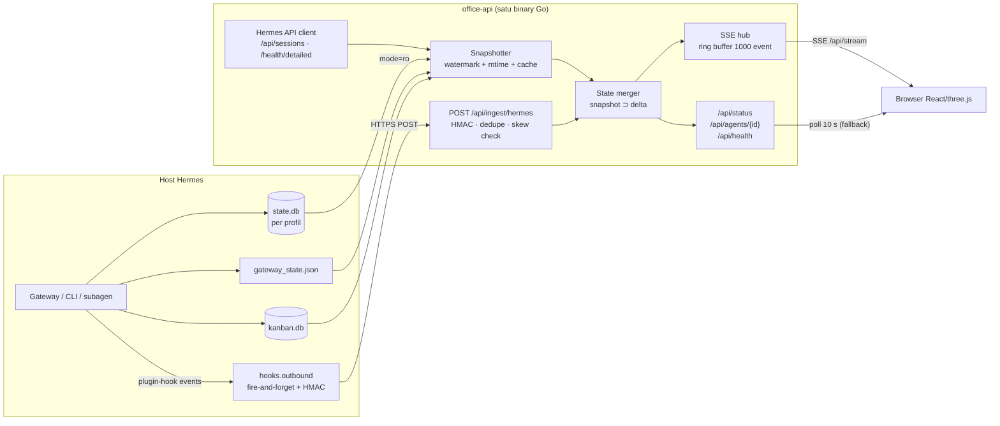
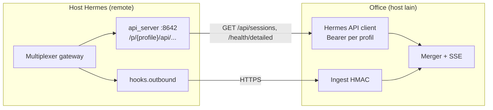
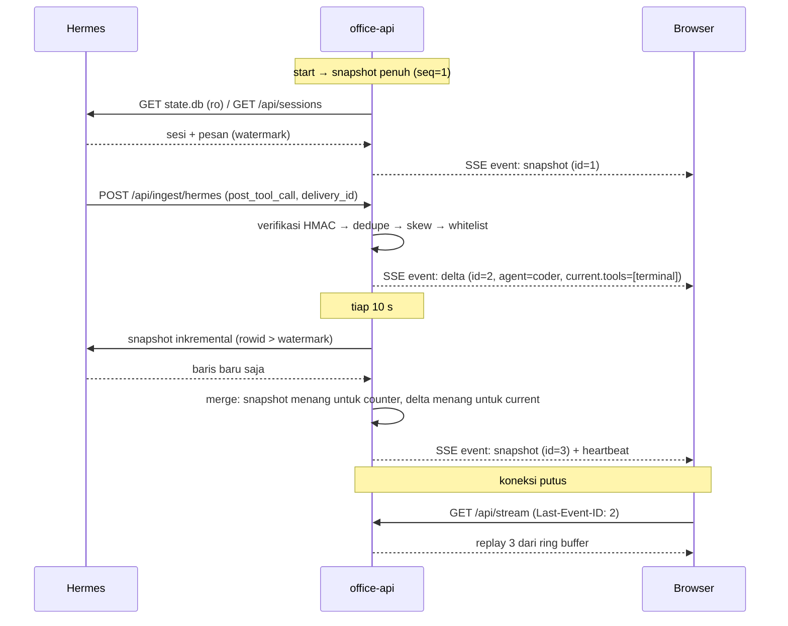

# Arsitektur Integrasi Hermes ↔ Kantor Virtual

**Laporan R&D — plug and play, deteksi agen otomatis, dan konsumsi metadata yang aman**

| | |
|---|---|
| Versi | 1.0 (draf untuk keputusan) |
| Tanggal | 15 November 2026 |
| Penulis | Agen R&D (subagent) |
| Untuk | Mas Afif |
| Status | Usulan — belum ada perubahan kode |
| Lingkup | `backend/` (Go), `frontend/` (React), interaksi dengan Hermes Agent |
| Basis kode | `feat/plug-and-play`, HEAD `f6a860e` + perubahan lokal yang belum di-commit |

---

## 1. Ringkasan eksekutif

Kantor virtual sekarang bekerja: 11 meja, status turunan dari `state.db`, API Go read-only, frontend 3D. Yang belum ada adalah **kontrak integrasi**: kantor membaca file internal Hermes secara langsung, dan itu mengikat kantor ke satu mesin, satu tata letak direktori, dan satu cara pengambilan data (polling penuh setiap 4 detik).

Laporan ini mengevaluasi delapan opsi arsitektur terhadap enam kebutuhan mas Afif: (a) plug and play lewat env, (b) deteksi agen otomatis termasuk profil baru, (c) hemat sumber daya, (d) tetap jalan bila kantor dipisah dari Hermes, (e) privasi metadata saja, (f) bisa dioperasikan satu orang.

**Temuan utama**

1. **Asumsi awal perlu dikoreksi.** Brief menyebut API server Hermes tidak punya endpoint status agen/sesi. Dokumentasi resmi menunjukkan sebaliknya: ada **Sessions API** (`GET /api/sessions`, paginasi, metadata) dan **`GET /health/detailed`** (status gateway, *active API runs*, *active delegations*, *pending process completions*) — keduanya di balik `API_SERVER_KEY` [S3][S4]. Ini membuka opsi "pull lewat API" yang jauh lebih bersih daripada membaca `state.db` dari jarak jauh. Yang tetap tidak ada: **endpoint status per-agen yang sudah jadi** — status meja masih harus diturunkan sendiri.
2. **Tidak ada satu sumber pun yang lengkap.** Push (outbound webhook) cepat tapi best-effort, bisa drop, dan tidak punya field profil anak untuk subagen [S1]. Snapshot (`state.db` atau API) lengkap tapi lambat dan mahal. Dashboard API menyajikan `/api/status` tanpa roster dan `/api/sessions` dengan *preview* isi pesan — dua-duanya bukan kontrak yang layak dijadikan tulang punggung [S5].
3. **Rekomendasi: hybrid "snapshot + push + SSE", satu binary.** Snapshot berkala sebagai kebenaran (reconciler), outbound webhook sebagai pemercepat delta, SSE ke browser sebagai pengganti polling 4 detik. Sumber snapshot bisa `state.db` (lokal) **atau** API server Hermes (remote) — dipilih lewat env, bukan lewat build berbeda.
4. **Skor matriks: hybrid 4,20/5**, disusul polling state.db 3,95 dan API-server-pull 3,80. Hybrid menang di tiga dari tiga skenario bobot alternatif, **tetapi** kalau bobot "kompleksitas operasional" dinaikkan ke 30%, hybrid (4,05) hanya unggul 0,05 dari polling (4,00) — praktis seri. Itu kelemahan jujur dari rekomendasi ini: ia menambah satu jalur data yang harus dijaga.
5. **Plug and play penuh lewat env tidak mungkin 100%.** Outbound webhook hanya bisa dikonfigurasi lewat `hooks.outbound:` di `config.yaml`, dan perubahan berlaku setelah restart gateway/CLI [S1]. Kompromi yang diusulkan: env untuk kantor, satu skrip idempoten untuk menulis blok webhook ke tiap profil (tetap "satu perintah").

**Yang tidak diusulkan:** menjadikan kanban satu-satunya sumber (terlalu sempit — hanya tugas, bukan aktivitas), menjadikan OTLP satu-satunya sumber (dirancang *content-free* dan justru **membuang nama profil** [S12], jadi tidak bisa memberi status per-meja), atau memakai dashboard sebagai API produksi (auth manusia, port terpisah, `preview` bocor isi pesan [S5]).

---

## 2. Kondisi sekarang (baseline yang diukur)

### 2.1 Alur data saat ini

```
Browser (React)                    office-api (Go)                  Hermes
──────────────                     ───────────────                  ──────
useStatus.ts                       GET /api/status
  poll 4 s  ─────────────────────► handleStatus()
  backoff 6/12/24/30 s               └─ src.Snapshot()
                                        └─ loader.Snapshot()
                                             ├─ for each profile:
                                             │    open state.db (mode=ro)
                                             │    SELECT sessions
                                             │    SELECT 12000 messages
                                             └─ derive.Build()
                                                  └─ agents/feed/tasks/comms
```

Bukti di repo:

| Fakta | Lokasi |
|---|---|
| Polling 4 detik, backoff 6/12/24/30 detik | `frontend/src/hooks/useStatus.ts:5-6` |
| Setiap request `/api/status` memanggil `Snapshot()` — tidak ada cache | `backend/internal/api/api.go:106-108` |
| Tiap snapshot membaca ulang **12.000 pesan per profil** | `backend/internal/loader/loader.go:21,69` |
| DB dibuka read-only (`mode=ro`, `query_only(1)`, `busy_timeout=2000`) | `backend/internal/store/store.go:73` |
| Roster = 11 profil bawaan + folder `profiles/*` yang punya `state.db` | `backend/internal/config/config.go:183-215` |
| Sumber data sudah diabstraksi (`local` / `remote`) | `backend/internal/source/source.go:19-45` |
| Kontrak status turunan (working/reviewing/blocked/idle/offline) | `README.md:117-136`, `backend/internal/derive/derive.go:16-23` |

### 2.2 Biaya nyata polling penuh

Dengan 11 profil dan 12.000 baris per profil, satu snapshot menyentuh **sampai 132.000 baris** (plus `sessions`). Itu terjadi **per request HTTP**, bukan per interval: tiga tab terbuka = tiga kali lipat. Pada `state.db` 200 MB, ini masih "cukup" (komentar di `loader.go:17-19` menyebutnya demikian), tetapi:

- tidak ada cache → beban naik linear dengan jumlah klien, bukan dengan jumlah agen;
- tidak ada watermark → pesan lama dibaca ulang walau tidak berubah;
- tidak ada pembedaan "file berubah" vs "file sama" → `mtime` diabaikan.

Ini alasan konkret mengapa kebutuhan (c) "hemat sumber daya" belum terpenuhi, dan mengapa perbaikan termurah (incremental + cache + satu pengumpul latar) sudah memberi sebagian besar manfaat tanpa mengubah arsitektur.

### 2.3 Yang sudah "plug and play" hari ini

Jangan mengulang pekerjaan yang sudah ada. Repo sudah punya:

- `OFFICE_SOURCE=local|remote` + `REMOTE_API_URL` (`backend/internal/config/config.go:59-90`);
- roster override lewat file/JSON, plus auto-append profil baru (`config.go:183`);
- `HERMES_HOME`, `PORT`, `BIND`, `OFFICE_TZ`, `OFFICE_TITLE`, `WEB_DIR` — semuanya env, tanpa hard-code home direktori (`config.go:1-12`);
- image tunggal (Dockerfile + `docker-compose.yml`, belum di-commit).

Jadi delta menuju target bukan "membangun ulang", melainkan **menambah satu jalur push + satu jalur pull berbasis API + cache inkremental**.

---

## 3. Apa yang benar-benar disediakan Hermes (fakta + rujukan)

Tabel ini adalah dasar semua keputusan di bawah. Setiap baris punya kutipan di Lampiran A.

| # | Permukaan | Sifat | Isi yang relevan untuk kantor | Batas |
|---|---|---|---|---|
| 1 | **Outbound webhooks** (`hooks.outbound:`) | push, fire-and-forget, notify-only | event plugin-hook: `pre/post_tool_call`, `pre/post_llm_call`, `on_session_start/end`, `subagent_start/stop`, dll; payload `profile`, `session_id`, `tool_name`, `tool_input`, `extra`, `delivery_id`, `timestamp`; HMAC-SHA256 header | retry sekali (koneksi/5xx), 4xx tidak, redirect tidak diikuti, queue terbatas → **event bisa drop**; konfigurasi hanya via `config.yaml`; payload memuat `tool_input` (bisa berisi konten) [S1] |
| 2 | **Gateway hooks** (`~/.hermes/hooks/<n>/HOOK.yaml`) | push, in-process | `gateway:startup`, `session:start/end/reset/compress`, `agent:start/step/end`, `command:*`; `agent:start` memuat `message` 500 char, `agent:end` memuat `response` 500 char | **hanya gateway**; "The CLI, TUI, Desktop and cron never load gateway hooks" [S2]. Tidak menangkap sesi CLI/subagent — mayoritas kerja kantor |
| 3 | **API server** (`hermes serve` / platform `api_server`) | pull, HTTP bearer | `/v1/chat/completions`, `/v1/responses`, `/v1/runs` (+SSE `/v1/runs/{id}/events`), `/v1/models`, `/v1/capabilities`, `/api/jobs`, **`/api/sessions`**, **`/health/detailed`**, `/v1/skills`, `/v1/toolsets` | semua di balik `API_SERVER_KEY`; tidak ada endpoint "status agen"; `/health/detailed` hanya profil aktif + hitungan [S3][S4] |
| 4 | **Web dashboard** (`hermes dashboard`) | pull, auth manusia | `GET /api/status` (versi, status gateway, platform, *active session count*), `GET /api/sessions` (20 terbaru + **preview**), `/api/pty` (WS) | port 9119, machine-level, bind non-loopback **wajib** auth; `/api/status` tanpa roster; `preview` = isi pesan [S5] |
| 5 | **Session storage** (`state.db`) | pull, filesystem | `sessions`, `messages`, `session_model_usage`, `messages_fts`, `gateway_routing`, `async_delegations`, `session_admissions`, `worker_executions`, … | SQLite WAL; reader read-only didukung; `read-only open` punya budget 5 s lalu 503; skema bisa berubah antar versi [S6] |
| 6 | **Multi-profile gateway** | topologi | satu listener, prefix `/p/<profile>/v1/...` dan `/p/<profile>/api/...`; `served_profiles` di `gateway_state.json`; rescan `profiles/` tiap 30 s | profil baru otomatis dilayani, tapi **hanya** kalau multiplexer aktif [S7] |
| 7 | **Profil** | topologi | direktori `~/.hermes/profiles/<nama>/` dianggap profil hanya jika punya salah satu identity file (`config.yaml`, `.env`, `SOUL.md`, `profile.yaml`, `auth.json`, `state.db`) | folder sisa logging/cron **bukan** profil; profil dihapus meninggalkan tombstone [S8] |
| 8 | **Kanban** | pull, SQLite | `~/.hermes/kanban.db`, baris durabel, `task_links`, board per proyek, dispatcher di gateway | single-host by design; satu dispatcher per instalasi [S9][S10] |
| 9 | **Plugin** (`ctx.register_hook`) | in-process | hook yang sama dengan #1, plus `pre/post_api_request`, `on_stream_delta`, `on_human_input_*`, `pre/post_approval_*`; correlation ID (`session_id`, `turn_id`, `task_id`, `tool_call_id`) | butuh `plugins.enabled` per profil; callback berjalan di proses agen; hook hot-path punya timeout 30 s, `pre_tool_call` **fail-closed** saat timeout [S1][S11][S13] |
| 10 | **OTLP gateway monitoring** | push, telemetry | gauge `hermes.gateway.up/state/active_agents/background_work`, span lifecycle, log diagnostik | "content-free by construction"; **tidak** mengekspor nama profil, sesi, atau trayektori [S12] |

### 3.1 Tiga konsekuensi yang menentukan desain

**(i) Push saja tidak cukup, dan bukan karena latensi.** Outbound webhook dijelaskan sebagai "best-effort, not guaranteed", dengan queue terbatas yang membuang event saat banjir [S1]. Kantor yang hanya push akan menampilkan meja yang "beku" setelah event hilang, tanpa cara mengetahui bahwa ia beku. Setiap arsitektur push **wajib** punya reconciler.

**(ii) Pull saja tidak cukup untuk kesegaran, tapi cukup untuk kebenaran.** Snapshot selalu benar (sumbernya state), tapi termurah pada interval 10–30 s. Aktivitas "sedang mengetik tool" akan terasa lambat kalau hanya snapshot.

**(iii) Metadata yang dibutuhkan kantor sebagian tidak ada di push.** `subagent_start` membawa `child_session_id`, `child_role`, `child_goal` — **tidak** membawa profil anak [S1]. Padahal meja anak (mis. `coder` yang dipanggil `dev`) justru inti tampilan kantor. Saat ini itu diakali di `derive.go` dengan membaca argumen `delegate_task` dan `model_config._subagent_id` (`README.md:127-131`). Push tidak bisa menggantikan trik itu; snapshot tetap harus jadi penentu atribusi subagen.

---

## 4. Opsi arsitektur

Delapan opsi: lima yang diminta (A–E) plus tiga yang saya tambahkan setelah membaca dokumentasi (F API server, G kanban, H OTLP). Untuk tiap opsi: cara kerja, kekuatan, kelemahan, dan kapan ia menang.

### A. Polling `state.db` seperti sekarang (diperbaiki inkremental)

**Cara kerja.** office-api membuka tiap `state.db` read-only, membaca `sessions` + `messages`, menurunkan status. Perbaikan yang diusulkan: satu goroutine pengumpul, watermark `(session_id, rowid)`, cek `mtime`+`size` sebelum query, cache snapshot dengan TTL, dan fan-out ke semua klien.

**Kekuatan.** Sumber kebenaran paling lengkap: token, counter harian, `end_reason`, tool error, delegasi, semuanya ada. Nol ketergantungan jaringan. Nol permukaan serangan baru. Tidak perlu mengubah Hermes sama sekali. Sudah terbukti jalan (24 test lulus).

**Kelemahan.** Butuh akses filesystem → gugur untuk deployment terpisah (kebutuhan d). Membaca isi pesan secara lokal (privasi terjaga hanya oleh disiplin kode). Skema `state.db` bisa berubah antar versi Hermes — pembaca rapuh jangka panjang. Tidak ada notifikasi: latensi = interval.

**Menang kalau:** kantor selalu satu mesin dengan Hermes, dan prioritasnya "sesedikit mungkin komponen".

### B. Push murni: outbound webhook + ingest HMAC

**Cara kerja.** `hooks.outbound:` di tiap profil menunjuk `https://office/api/ingest/hermes`; kantor memverifikasi HMAC, dedupe `delivery_id`, menyimpan event ke ring buffer, dan menyusun status dari event.

**Kekuatan.** Latensi ~1 detik. Tanpa akses filesystem (kebutuhan d terpenuhi). Beban Hermes minimal: "fire-and-forget, off the hot path", satu thread latar [S1]. Payload sudah membawa `profile`, jadi atribusi meja benar untuk sesi normal.

**Kelemahan (jujur).** (1) Tidak lengkap: counter harian, token, `today.hourly`, dan atribusi subagen tidak bisa direkonstruksi tanpa backfill. (2) Tidak tahan restart: event yang lewat saat kantor mati hilang permanen. (3) Queue terbatas → drop saat storm. (4) Konfigurasi bukan env. (5) Payload memuat `tool_input`, `child_goal`, `child_summary` — risiko privasi tinggi kalau tidak di-whitelist. (6) `on_session_end` bersifat turn-scoped, bukan batas hidup sesi [S11], jadi "sesi selesai" bisa salah tafsir.

**Menang kalau:** tidak pernah — sendirian ia terlalu rapuh. Berguna sebagai komponen.

### C. Hybrid: snapshot berkala + push delta + SSE ke browser ★

**Cara kerja.** Tiga lapisan:

1. **Snapshotter** (latar, interval `OFFICE_SNAPSHOT_MS`, default 10 s) membangun snapshot penuh dari `state.db` **atau** API server, inkremental bila memungkinkan.
2. **Ingest push** menerima webhook, memverifikasi HMAC, dan menimpa sebagian state (status, `current.tools`, feed) dengan delta ber-timestamp.
3. **SSE hub** mendorong snapshot/delta ke browser; polling 4 s tetap ada sebagai fallback.

**Kekuatan.** Latensi push + kelengkapan snapshot + ketahanan (reconciler menambal event hilang). Satu binary, env-only. Bisa lokal maupun remote (sumber snapshot ditukar). Frontend tidak perlu dirombak: `/api/status` tetap sama, SSE aditif.

**Kelemahan.** Dua jalur data = dua kemungkinan tidak konsisten; butuh aturan merge yang eksplisit dan metrik "push gap". Kode bertambah: HMAC, dedupe, ring buffer, SSE fan-out, merge. Operasional naik satu tingkat: sekarang ada secret yang harus dirotasi.

**Menang kalau:** keenam kebutuhan dipenuhi sekaligus — ini pemenang matriks.

### D. Plugin Hermes (`ctx.register_hook`) menulis spool lokal

**Cara kerja.** Plugin kecil di `~/.hermes/plugins/office-spool/` mendaftarkan `post_tool_call`, `on_session_start/end`, `subagent_*`, lalu **append** JSONL (atau baris SQLite) ke `~/.hermes/cache/office/events.jsonl`. Kantor membaca file itu secara tail.

**Kekuatan.** Latensi sangat rendah (~100 ms), tanpa jaringan, tanpa secret, dan menangkap CLI **dan** gateway (plugin hook berjalan di keduanya [S11]). Bisa memuat field yang tidak ada di webhook (mis. `turn_id`, `tool_call_id`, `status` observer-grade) karena plugin menerima `**kwargs` penuh.

**Kelemahan.** (1) Harus dipasang & di-enable di **11 profil** (`plugins.enabled` per profil [S13]) — operasional berat, dan bertentangan dengan "env saja". (2) Butuh akses filesystem → gugur untuk remote. (3) Kode berjalan di dalam proses agen; bug atau I/O lambat di callback `post_tool_call` menahan loop sampai timeout 30 s [S11]. (4) Bukan permukaan yang stabil untuk pihak ketiga jangka panjang — API plugin bisa berubah. (5) Kalau plugin gagal dimuat, kantor diam-diam kosong.

**Menang kalau:** kantor satu mesin, dan kita bersedia merawat plugin di setiap profil demi latensi maksimal.

### E. Konsumsi dashboard API internal

**Cara kerja.** Kantor memanggil `http://127.0.0.1:9119/api/status` dan `/api/sessions` dengan sesi login dashboard.

**Kekuatan.** Tidak perlu menyentuh DB; sudah ada; auth sudah ada (non-loopback wajib auth provider [S5]).

**Kelemahan.** `/api/status` hanya memberi versi, status gateway, platform, dan **jumlah** sesi aktif — bukan roster [S5]. `/api/sessions` memberi 20 sesi terbaru **dengan preview isi pesan** [S5] → melanggar kebutuhan (e) secara struktural. Dashboard adalah UI machine-level yang butuh auth manusia; memakainya sebagai API produksi berarti mengikat kantor ke HTML-nya. Menambah satu proses (dashboard) yang harus hidup terus.

**Menang kalau:** tidak. Hanya sebagai sumber cadangan untuk "gateway hidup/mati".

### F. Pull lewat API server Hermes (temuan baru)

**Cara kerja.** Kantor memanggil `GET /api/sessions?limit=…` (metadata sesi, paginasi) dan `GET /health/detailed` (status gateway, active runs, delegations) dengan `Authorization: Bearer $API_SERVER_KEY`. Untuk banyak profil: satu listener multiplexer, prefix `/p/<profile>/api/...`, key per profil [S7].

**Kekuatan.** Tanpa filesystem (kebutuhan d). Auth bawaan. Versi-skema aman (bukan baca tabel). Satu port untuk semua profil di bawah multiplexer. Bisa dikombinasikan dengan SSE `/v1/runs/{id}/events` untuk run yang diketahui.

**Kelemahan.** Field per sesi yang tersedia **belum terverifikasi rinci** — dokumentasi hanya menyebut "metadata"; apakah `end_reason`, `updated_at`, dan hitungan tool ada, perlu diuji. Tidak ada "tool yang sedang jalan" → `current.kind` tidak bisa diisi seakurat snapshot `messages`. Butuh `API_SERVER_ENABLED` + `API_SERVER_KEY` di tiap profil (env — jadi ini justru **cocok** dengan kebutuhan a). Menambah permukaan auth jaringan.

**Menang kalau:** kantor dipisah dari Hermes dan kita tidak mau membuka port baru untuk push.

### G. Kanban sebagai sumber (hanya tugas)

`~/.hermes/kanban.db` menyimpan setiap tugas sebagai baris durabel, dengan assignee, status, dan `task_links` [S9]. Ini **lebih baik** daripada `tasks[]` turunan sekarang untuk papan tugas: status kanban adalah kebenaran, bukan tebakan dari sesi. Tapi ia tidak tahu apa-apa soal "agen sedang apa" — bukan pengganti, melainkan **pelengkap** untuk `/api/tasks`. Catatan: single-host, dan satu dispatcher per instalasi [S10].

### H. OTLP gateway monitoring (ditolak)

Terlihat menarik karena content-free, tapi dirancang untuk operator infrastruktur: ia mengekspor `hermes.gateway.active_agents`, `background_work`, dan status platform, sementara **nama profil, job, dan sesi sengaja tidak diekspor** ("Never add an attribute that can hold a job name, prompt, output, schedule, destination, raw exception text, file path, profile name, account id") [S12]. Kantor butuh per-meja; OTLP memberi per-mesin. Berguna nanti untuk alert "gateway mati", bukan untuk status meja.

---

## 5. Matriks keputusan berbobot

### 5.1 Bobot dan justifikasinya

| Kriteria | Bobot | Alasan bobot |
|---|---:|---|
| Latensi | 20% | Kantor adalah dashboard live; 4 s sekarang sudah terasa cukup, jadi latensi penting tapi bukan dominan. |
| Kelengkapan data | 20% | Tanpa counter/token/tugas, kantor kehilangan alasan untuk dilihat. Setara latensi. |
| Ketahanan restart/loss | 15% | Event hilang = meja beku tanpa peringatan. Ini risiko diam yang paling berbahaya. |
| Kompleksitas operasional | 15% | Kebutuhan (f): satu orang, tanpa on-call. |
| Kebutuhan akses filesystem | 10% | Kebutuhan (d): deployment terpisah harus mungkin, tapi bukan skenario utama hari ini. |
| Keamanan/privasi | 10% | Kebutuhan (e) mutlak, tapi sebagian besar bisa dijamin di level kode (whitelist), bukan arsitektur. |
| Effort implementasi | 10% | Menentukan kapan manfaatnya datang, bukan apakah layak. |

Skor 1–5: **5 = paling baik** untuk kriteria itu (untuk "kebutuhan akses FS" dan "effort", 5 = paling ringan).

### 5.2 Skor

| Opsi | Latensi | Kelengkapan | Ketahanan | Ops | Akses FS | Keamanan | Effort | **Total** |
|---|:--:|:--:|:--:|:--:|:--:|:--:|:--:|--:|
| A. Polling `state.db` (diperbaiki) | 3 | 5 | 5 | 4 | 1 | 4 | 5 | **3,95** |
| B. Push murni (webhook) | 5 | 2 | 2 | 3 | 5 | 3 | 3 | **3,25** |
| **C. Hybrid snapshot+push+SSE** | 5 | 5 | 5 | 3 | 4 | 4 | 2 | **4,20** |
| D. Plugin spool lokal | 5 | 4 | 4 | 2 | 1 | 4 | 2 | **3,40** |
| E. Dashboard API | 4 | 2 | 4 | 3 | 5 | 2 | 4 | **3,35** |
| F. API server pull | 4 | 3 | 4 | 4 | 5 | 4 | 3 | **3,80** |

### 5.3 Analisis sensitivitas

Tiga set bobot alternatif, dihitung ulang:

| Skenario | Bobot yang diubah | Pemenang | C | A | F |
|---|---|---|--:|--:|--:|
| Basis | — | **C** | 4,20 | 3,95 | 3,80 |
| Latensi dominan | Latensi 30%, ops 10% | **C** | 4,30 | 3,80 | 3,85 |
| Ops dominan | Ops 30%, effort 5%, latensi 10% | **C** (tipis) | 4,05 | 4,00 | 3,85 |
| Remote wajib | Akses FS 25%, latensi 15% | **C** | 4,30 | 3,50 | 4,00 |

**Bacaan jujur:** C menang di semua skenario, tetapi pada "ops dominan" selisihnya 0,05 — dalam batas galat penilaian. Artinya: **kalau mas Afif mengutamakan sesedikit mungkin komponen, A yang diperbaiki adalah pilihan yang sama masuk akalnya**, dan C hanya layak bila kita memang butuh latensi sub-detik dan/atau deployment remote. Saya tetap merekomendasikan C karena (d) sudah masuk lingkup kebutuhan, dan karena C menyertakan A sebagai salah satu modenya — bukan menggantikannya.

---

## 6. Arsitektur target yang diusulkan

### 6.1 Prinsip

1. **Satu binary, banyak mode.** `OFFICE_SOURCE=local|hermes-api|remote` — bukan build berbeda, bukan service berbeda.
2. **Snapshot adalah kebenaran; push adalah pemercepat.** Setiap delta push selalu bisa dikalahkan oleh snapshot yang lebih baru.
3. **Kontrak lama tidak berubah.** `/api/status` tetap mengirim bentuk JSON yang sama; SSE dan ingest aditif.
4. **Privasi di titik masuk.** Field yang tidak ada di whitelist dibuang **sebelum** disimpan, bukan disaring saat render.
5. **Gagal dengan terlihat.** Kalau push berhenti, `/api/health` dan UI harus bilang "degraded: push", bukan diam.

### 6.2 Diagram komponen



Mode remote (tanpa akses filesystem):



### 6.3 Alur data (sequence)



### 6.4 Aturan merge (inti kebenaran)

| Field | Penentu | Alasan |
|---|---|---|
| `today.*`, `total.*`, `hourly` | **snapshot** | Hanya bisa dihitung dari `messages`/`session_model_usage` |
| `task`, `source` (subagen) | **snapshot** | Push tidak membawa profil anak |
| `status` (working/reviewing/blocked/idle) | snapshot, **kecuali** ada delta lebih baru dari `last_active` | Delta membuat "working" muncul dalam ~1 s |
| `current.kind`, `current.tools` | **delta terbaru** (fallback snapshot) | Inilah yang bikin kantor terasa hidup |
| `feed[]` | gabungan, dedupe `(agent, ts, kind, tools)` | Feed = kronologi, bukan state |
| `blocked` | snapshot (butuh 2 tool error berturut) | Delta bisa menghitung, tapi rawan false positive |
| `gateway.state` | `gateway_state.json` (lokal) / `/health/detailed` (remote) | Sumber resmi status proses |

Konflik diselesaikan dengan **waktu terima** (`received_at`), bukan `timestamp` pengirim, agar jam yang miring tidak membalik urutan. `timestamp` hanya dipakai untuk menolak event basi.

### 6.5 Kontrak endpoint

**Tetap (kompatibel penuh):**

| Endpoint | Perubahan |
|---|---|
| `GET /api/status` | bentuk sama; **ditambah** `meta{source, seq, generated_at, push_age_s, degraded}` |
| `GET /api/agents/{id}` | sama |
| `GET /api/config` | sama |
| `GET /api/health` | ditambah `ingest{enabled, last_event_at, accepted, rejected, duplicates, stale}` dan `snapshot{last_at, duration_ms, rows_read}` |

**Baru:**

| Endpoint | Metode | Fungsi | Auth |
|---|---|---|---|
| `/api/stream` | GET (SSE) | `snapshot`, `delta`, `heartbeat`; header `id:` = seq, mendukung `Last-Event-ID` | publik (read-only), opsional token bila `OFFICE_PUBLIC=1` |
| `/api/ingest/hermes` | POST | terima webhook Hermes | HMAC `X-Hermes-Signature-256` |
| `/api/tasks` | GET | papan tugas dari `kanban.db` (bila ada) | publik |

**Contoh delta SSE:**

```json
{
  "seq": 4211,
  "received_at": 1794668541.39,
  "agent": "coder",
  "patch": {
    "status": "working",
    "last_active": 1794668541.2,
    "current": { "kind": "tool_call", "tools": ["terminal"] }
  },
  "feed": [{ "agent": "coder", "ts": 1794668541.2, "kind": "tool_call", "tools": ["terminal"] }]
}
```

**Amplop event internal (setelah whitelist):**

```json
{
  "delivery_id": "3f2c9a...",
  "event": "post_tool_call",
  "profile": "coder",
  "session_id": "sess_abc123",
  "tool_name": "terminal",
  "status": "ok",
  "duration_ms": 812,
  "received_at": 1794668541.39
}
```

Field yang **tidak pernah** disimpan: `tool_input`, `result`, `child_goal`, `child_summary`, `message`, `response`, `cwd` (default; bisa diaktifkan sadar lewat `OFFICE_STORE_CWD=1`), `preview`, isi `messages.content`.

### 6.6 Environment variables

| Variabel | Default | Mode | Arti |
|---|---|---|---|
| `OFFICE_SOURCE` | `local` | semua | `local` \| `hermes-api` \| `remote` |
| `HERMES_HOME` | `~/.hermes` | local | sumber `state.db`, `gateway_state.json`, `kanban.db` |
| `HERMES_API_URL` | `http://127.0.0.1:8642` | hermes-api | base API server |
| `HERMES_API_KEY` | — | hermes-api | bearer untuk profil default |
| `HERMES_API_KEYS` | — | hermes-api | `dev=key1,coder=key2` untuk mode multiplexer `/p/<profile>/` |
| `HERMES_API_PROFILES` | `auto` | hermes-api | `auto` = ambil dari `served_profiles`; atau daftar eksplisit |
| `OFFICE_SNAPSHOT_MS` | `10000` | local, hermes-api | interval snapshotter |
| `OFFICE_STREAM` | `1` | semua | `1` aktifkan SSE, `0` polling saja (rollback) |
| `OFFICE_STREAM_HEARTBEAT_MS` | `15000` | semua | heartbeat SSE |
| `OFFICE_INGEST` | `1` | semua | `1` aktifkan `/api/ingest/hermes` |
| `OFFICE_INGEST_SECRET` | — | semua | secret HMAC (atau `_FILE`) |
| `OFFICE_INGEST_SECRET_PREV` | — | semua | secret lama untuk rotasi tanpa downtime |
| `OFFICE_INGEST_SKEW_S` | `300` | semua | toleransi jam |
| `OFFICE_INGEST_MAX_BYTES` | `65536` | semua | batas body |
| `OFFICE_KANBAN_DB` | `$HERMES_HOME/kanban.db` | local | papan tugas |
| `OFFICE_STORE_CWD` | `0` | semua | simpan `cwd`? (default tidak) |
| `OFFICE_PROFILE_RULE` | `identity` | local | `identity` (mengikuti [S8]) atau `state_db` (perilaku lama) |
| `PROFILES` | 11 bawaan | local | override roster |
| `PORT` / `BIND` | `8131` / `127.0.0.1` | semua | listener |
| `OFFICE_TZ` | `Asia/Jakarta` | semua | batas hari & bucket jam |
| `WEB_DIR` | — | semua | serve SPA dari binary |

Catatan: **tidak ada** env untuk `hooks.outbound` — itu hidup di `config.yaml` Hermes [S1]. Karena itu disediakan `deploy/install-webhook.sh` (idempoten: baca YAML, tambah/ubah blok `outbound` bila belum ada, tulis secret ke `.env` profil, restart gateway). Satu perintah, tetap "plug and play" dari sudut pandang operator.

### 6.7 Strategi rekonsiliasi saat event hilang

| Gejala | Deteksi | Tindakan |
|---|---|---|
| Push berhenti total | `now - ingest.last_event_at > 120 s` sementara snapshot melihat `last_active` lebih baru | `meta.degraded="push"`, UI menampilkan titik abu-abu di HUD, log WARN sekali per menit |
| Event hilang sebagian | `snapshot.last_active > last_delta[profile]` + `> 60 s` | delta disintesis dari snapshot untuk profil itu; tandai `feed` sebagai "dari snapshot" |
| Event duplikat | `delivery_id` sudah ada di ring buffer (10.000 id / 15 menit) | dibuang, `duplicates++` |
| Event basi/replay | `abs(now - timestamp) > OFFICE_INGEST_SKEW_S` | ditolak 400, `stale++` |
| Kantor restart | mulai dari snapshot penuh, `seq` reset dengan epoch baru | browser kirim `Last-Event-ID` lama → server balas `snapshot` penuh (bukan replay) |
| Snapshot gagal (DB terkunci) | error dari `store.Open`/query | pertahankan snapshot terakhir + `meta.stale_s`, jangan kosongkan ruangan |
| Hermes upgrade mengubah skema | query `pragma_table_info` gagal untuk kolom yang diharapkan | fallback ke kolom minimal (`id`, `session_id`, `role`, `timestamp`), log WARN, `meta.schema="degraded"` |

Prinsip: **kantor tidak boleh pernah menampilkan ruangan kosong sebagai fakta.** Ruangan kosong hanya sah kalau snapshot berhasil dan memang tidak ada sesi.

### 6.8 Rencana migrasi bertahap (tanpa downtime)

| Fase | Isi | Gate (harus lulus) | Rollback |
|---|---|---|---|
| **0. Sekarang** | v2.2 polling penuh | — | — |
| **1. Snapshotter + cache + SSE (aditif)** | Satu goroutine snapshot, cache TTL, `/api/stream`. `OFFICE_STREAM=0` = perilaku lama persis | `go test ./...` hijau; `/api/status` byte-identik dengan v2.2 pada fixture; beban CPU turun ≥50% saat 3 klien | set `OFFICE_STREAM=0`, redeploy binary lama |
| **2. Ingest + HMAC, pilot 1 profil** | `/api/ingest/hermes`, dedupe, whitelist; webhook hanya untuk profil `dev` | 1.000 event pilot: 0 panic, 0 field terlarang tersimpan, `duplicates` wajar, latency p95 < 50 ms | `OFFICE_INGEST=0`, hapus blok webhook profil `dev` |
| **3. Push semua profil** | `install-webhook.sh --all`; snapshot turun ke 10 s sebagai reconciler | 24 jam: `push_age_s` < 5 s pada 95% waktu; tidak ada delta yatim | hapus blok `outbound`, snapshot tetap jalan |
| **4. Mode `hermes-api`** | Klien `/api/sessions` + `/health/detailed`; uji di host terpisah | paritas status ≥95% vs mode local pada jam kerja yang sama | `OFFICE_SOURCE=local` |
| **5. Frontend SSE** | `useStatus` pakai `EventSource`, fallback polling saat `onerror` | 30 menit tanpa reload, memori stabil, reconnect < 2 s | env `OFFICE_STREAM=0` (frontend otomatis fallback) |

Urutannya sengaja: setiap fase **menambah** kemampuan dan bisa dimatikan dengan satu env, tanpa menyentuh kontrak `/api/status`. Fase 1 saja sudah memenuhi (c); fase 2–3 memenuhi (a)+(e); fase 4 memenuhi (d); fase 5 memenuhi "terasa hidup".

### 6.9 Yang berubah di kode (perkiraan)

| Berkas | Perubahan | Baris (perkiraan) |
|---|---|---|
| `backend/internal/source/local.go` | snapshotter + watermark + cache | +150 |
| `backend/internal/source/hermesapi.go` (baru) | klien `/api/sessions`, `/health/detailed` | +220 |
| `backend/internal/ingest/` (baru) | HMAC, dedupe, whitelist, ring buffer | +300 |
| `backend/internal/api/api.go` | `/api/stream`, `/api/ingest/hermes`, `/api/tasks` | +180 |
| `backend/internal/derive/derive.go` | merge delta + `meta` | +120 |
| `frontend/src/hooks/useStatus.ts` | EventSource + fallback | +80 |
| `deploy/install-webhook.sh` (baru) | tulis `hooks.outbound` per profil | +90 |

Total ~1.100 baris. Tidak ada perubahan pada `state.db` Hermes, tidak ada patch ke Hermes.

---

## 7. Keamanan dan privasi

### 7.1 Threat model

| # | Ancaman | Vektor | Kontrol | Risiko sisa |
|---|---|---|---|---|
| T1 | Palsu event (spoof) | POST langsung ke `/api/ingest/hermes` | HMAC-SHA256 atas **raw body**, `hmac.compare_digest`, secret 32+ byte dari env/file [S1] | bila secret bocor, penyerang bisa memalsukan status |
| T2 | Replay | kirim ulang request sah | `delivery_id` dedupe (10k/15 mnt) + `timestamp` skew 300 s; keduanya **di dalam** body bertanda tangan [S1] | replay dalam window dengan id baru tidak mungkin tanpa secret |
| T3 | Kebocoran isi pesan | payload memuat `tool_input`, `child_goal`, `child_summary` | whitelist field di ingress; test unit yang gagal bila field terlarang tersimpan | field baru dari Hermes bisa lolos bila whitelist tidak di-review |
| T4 | DoS / banjir event | event storm atau penyerang | `MaxBytesReader` 64 KB, rate limit per IP, ring buffer terbatas, drop tertua + metrik | kantor bisa "buta" sementara saat storm |
| T5 | Penyadapan | endpoint publik tanpa TLS | wajib HTTPS di belakang Caddy; HMAC **tidak** menyembunyikan isi | MITM bisa melihat metadata |
| T6 | Akses UI publik | `office.afifnurzein.my.id` tanpa auth (kondisi sekarang, `README.md:88`) | opsional `OFFICE_PUBLIC_TOKEN` atau basic auth di Caddy | metadata roster (nama, status, tool) terbuka |
| T7 | Escalation lewat plugin | opsi D: plugin berjalan in-process | tidak dipakai di rekomendasi; bila dipakai: hanya hook observer, tanpa import Hermes internal | — |

### 7.2 Aturan payload: apa yang boleh

| Boleh | Tidak boleh |
|---|---|
| `profile`, `session_id` (pseudonim), `tool_name` | `tool_input` (bisa memuat pesan pengguna) |
| `status` (`ok`/`error`/`blocked`/`cancelled`), `duration_ms` | `result`, `response`, `message`, `preview` |
| `event`, `delivery_id`, `timestamp`, `received_at` | `child_goal`, `child_summary` |
| nama tool dari `tool_call_history` (sudah metadata-only) | `cwd` (default mati), path proyek, isi berkas |
| hitungan (`tokens`, `messages`, `sessions`) | nama pengguna, chat id, nomor telepon |

Catatan penting: dokumentasi menyatakan payload outbound "include tool inputs and event metadata" dan menganjurkan hanya menunjuk endpoint tepercaya [S1]. Jadi **penyaringan bukan opsional** — ia bagian dari kontrak, bukan penyempurnaan.

### 7.3 Bila endpoint publik

- Bind `127.0.0.1` untuk API baca; hanya `/api/ingest/hermes` yang diekspos (lewat Caddy `handle /api/ingest/*`).
- Tolak selain `POST` + `application/json`; batas body; timeout baca 5 s.
- Jangan pernah mengembalikan detail error internal (cukup `{"ok":false,"code":"bad_signature"}`).
- Log `delivery_id` + `profile` + hasil verifikasi — **bukan** body.
- Rotasi secret: `OFFICE_INGEST_SECRET` baru + `OFFICE_INGEST_SECRET_PREV` lama selama 24 jam, lalu hapus yang lama.
- Alternatif lebih aman untuk deployment remote: taruh Hermes dan kantor di Tailscale/WireGuard, ingest hanya listen di IP privat. Push lintas NAT tanpa VPN akan gagal; itu keputusan topologi, bukan kode.

### 7.4 Privasi hari ini vs target

Sekarang: isi pesan dibaca lokal untuk menandai tool error dan hasil delegasi, tidak pernah dikirim ke klien (`README.md:133-136`). Target mempertahankan itu dan menambah satu lapisan: **isi pesan tidak lagi melewati jaringan sama sekali** untuk jalur push, dan untuk jalur API server kantor hanya meminta metadata sesi — bukan `/api/sessions/{id}/messages`, yang jelas-jelas berisi transkrip [S3].

---

## 8. Operasional (satu orang)

### 8.1 Runbook minimal

```bash
# status sekilas
curl -s localhost:8131/api/health | jq '{source, snapshot, ingest, degraded}'

# apakah push masih hidup?
curl -s localhost:8131/api/health | jq '.ingest.last_event_at, .snapshot.last_at'

# pasang webhook ke semua profil (idempoten)
deploy/install-webhook.sh --all --url https://office.example.com/api/ingest/hermes

# matikan push, kembali ke snapshot saja (rollback 1 perintah)
OFFICE_INGEST=0 systemctl --user restart virtual-office-api
```

### 8.2 Metrik yang layak dipantau

| Metrik | Ambang | Arti |
|---|---|---|
| `snapshot_age_s` | > 3× interval | snapshotter macet |
| `push_age_s` | > 120 s saat ada aktivitas | push mati |
| `ingest_rejected_total` | naik terus | secret salah / penyerang |
| `ingest_duplicates_total` | > 5% event | retry berlebih (endpoint lambat) |
| `snapshot_duration_ms` p95 | > 500 ms | DB membesar, watermark tidak bekerja |
| `sse_clients` | 0 saat ada tab terbuka | proxy memutus SSE |

### 8.3 Beban yang diharapkan

| Skenario | Sekarang | Target |
|---|---|---|
| 11 profil, 1 klien, 4 s | ~132k baris / 4 s | ~2k baris / 10 s (hanya yang baru) |
| 3 klien | 3× lipat | tetap 1× (cache + fan-out) |
| Latensi perubahan status | 0–4 s | 0,3–1,5 s (push) |
| Proses tambahan | 0 | 0 (semua di binary yang sama) |

Angka target adalah **perkiraan desain**, bukan hasil pengukuran — lihat §10.

---

## 9. Risiko dan hal yang belum terverifikasi

### 9.1 Risiko utama

| Risiko | Dampak | Mitigasi |
|---|---|---|
| Dua jalur data tidak konsisten | meja "hidup" padahal sesi selesai | aturan merge eksplisit (§6.4) + `meta.degraded` |
| Perubahan skema `state.db` | snapshot rusak setelah upgrade Hermes | fallback kolom minimal + test fixture lintas versi |
| Outbound webhook dihapus saat upgrade | push mati diam-diam | `push_age_s` alert; snapshot tetap jalan |
| Operator lupa rotasi secret | replay window melebar | dua secret + TTL 24 jam, checklist |
| SSE di belakang Caddy buffering | UI tidak update | header `X-Accel-Buffering: no`, `flush_interval -1`, uji dengan `curl -N` |
| Kompleksitas naik | sulit dirawat sendiri | tiap fase punya kill switch env |

### 9.2 Belum terverifikasi (jangan dipakai sebagai fakta)

1. **Ukuran bounded queue outbound webhook** — dokumentasi menyebut "bounded queue" tanpa angka [S1].
2. **Apakah `delivery_id` unik global** atau hanya per proses/instalasi.
3. **Field persis `GET /api/sessions`** — dokumentasi menyebut "metadata" dan paginasi; apakah `end_reason`, `updated_at`, hitungan tool ada, belum dipastikan. Perlu satu `curl` ke instance nyata.
4. **Apakah `/health/detailed` melaporkan per profil** atau hanya profil aktif listener.
5. **Apakah outbound webhook mengirim event subagen dengan `profile` anak** — daftar field resmi tidak memuatnya [S1].
6. **Format `gateway_state.json`** bukan kontrak terdokumentasi; kode sekarang membacanya toleran (`loader.go:105-160`).
7. **Kuota/rate limit** dashboard dan API server.
8. **Apakah `hermes serve` dan platform `api_server` berbagi port yang sama** dalam semua topologi.
9. **Perilaku `on_session_end` untuk sesi yang di-`/new`** — dokumen menyebut turn-scoped [S11]; implikasi ke "sesi selesai" belum diuji.
10. **Angka beban target di §8.3** — desain, bukan pengukuran.

---

## 10. Pertanyaan terbuka untuk mas Afif

| # | Pertanyaan | Kenapa penting | Default usulan |
|---|---|---|---|
| 1 | Kantor akan selalu satu mesin dengan Hermes, atau dipisah? | Menentukan `OFFICE_SOURCE` default dan apakah fase 4 perlu | satu mesin dulu, siapkan `hermes-api` |
| 2 | Kalau dipisah: boleh membuka endpoint ingest ke internet, atau lewat VPN/Tailscale? | Menentukan desain keamanan (T5) | Tailscale; ingest tidak publik |
| 3 | Topologi Hermes: satu multiplexer atau satu gateway per profil? | Menentukan URL API (`/p/<profile>/`) dan jumlah blok webhook | multiplexer (default Hermes) |
| 4 | Latensi sub-detik sepadan dengan satu jalur data tambahan? | Kalau tidak, opsi A sudah cukup (selisih skor 0,05 pada bobot ops) | ya, karena (d) juga dibutuhkan |
| 5 | Atribusi meja untuk subagen: cukup aproksimasi snapshot, atau ajukan field `child_profile` ke Hermes? | Push tidak punya field itu; saat ini diakali | aproksimasi dulu, usul upstream belakangan |
| 6 | Papan tugas: kanban jadi sumber resmi, atau tetap turunan sesi? | Mengubah `/api/tasks` dan arti "tugas" | kanban bila board dipakai; else turunan |
| 7 | Retensi: berapa lama event & rollup harian disimpan? | Butuh SQLite kecil di kantor (bukan di Hermes) | 30 hari event, rollup selamanya |
| 8 | Siapa pemegang secret HMAC, dan boleh skrip menulis `config.yaml` profil? | Ini satu-satunya bagian yang tidak bisa env-only | mas Afif; skrip idempoten + backup |
| 9 | `tool_name` dan `session_id` boleh tampil di UI publik? | Metadata tetap bisa mengungkap kebiasaan kerja | `tool_name` ya, `session_id` tidak |
| 10 | UI kantor perlu auth? | Sekarang publik tanpa auth (`README.md:88`) | token sederhana di Caddy |

---

## Lampiran A — Rujukan (URL + kutipan)

| Kode | Sumber | Kutipan kunci |
|---|---|---|
| **S1** | [Event Hooks → Outbound Webhooks](https://hermes-agent.nousresearch.com/docs/user-guide/features/hooks#outbound-webhooks) | "Add a `hooks.outbound:` list to `~/.hermes/config.yaml`… Any event from the plugin-hook set is valid… `secret_env`… Changes take effect on the next CLI session / gateway restart." · "Fire-and-forget, off the hot path… Notify-only… Connection errors and 5xx responses are retried once with backoff; 4xx responses are not retried… delivery is best-effort, not guaranteed." · "Bounded queue. If the queue backs up… new events are dropped with a warning." · "payloads include tool inputs and event metadata, so only point targets at endpoints you trust." |
| **S2** | [Event Hooks → Gateway Event Hooks](https://hermes-agent.nousresearch.com/docs/user-guide/features/hooks#gateway-event-hooks) | "Gateway hooks fire automatically during gateway operation… `agent:step` — Each iteration of the tool-calling loop." · "Gateway hooks only fire in the **gateway**… The CLI does not load gateway hooks." · "`agent:start` … `message` (truncated to 500 chars)" |
| **S3** | [API Server](https://hermes-agent.nousresearch.com/docs/user-guide/features/api-server) | "`GET /health/detailed` … reports bounded status for the active profile's config, state database, configured model, disk space, gateway/platform state, active API runs, pending process completions, and active delegations. The response exposes status and counts, not config values, credentials, paths, commands, queue payloads, or raw errors." · "`GET /v1/skills` and `GET /v1/toolsets`… gated by `API_SERVER_KEY`." |
| **S4** | [API Server → Sessions API](https://hermes-agent.nousresearch.com/docs/user-guide/features/api-server#sessions-api-session-control-over-rest) | "External UIs can manage Hermes sessions over REST without standing up the dashboard. All endpoints are gated by `API_SERVER_KEY`… `GET /api/sessions` — List sessions (paginated — `limit`, `offset`, `source`, `include_children`)". |
| **S5** | [Web Dashboard](https://hermes-agent.nousresearch.com/docs/user-guide/features/web-dashboard) | "`GET /api/status` — Returns agent version, gateway status, platform states, and active session count." · "`GET /api/sessions` — Returns the 20 most recent sessions with metadata (model, token counts, timestamps, preview)." · "a non-loopback bind always requires an auth provider" |
| **S6** | [Session Storage](https://hermes-agent.nousresearch.com/docs/developer-guide/session-storage) | "`~/.hermes/state.db` (SQLite, WAL mode)… **WAL mode** for concurrent readers + one writer" · "Several processes still open one `state.db`: the gateway…, read-only browsers (dashboard, `hermes sessions list`)…" · "a read-only open waits its `_READ_BUSY_TIMEOUT_S` (5 s) read budget once. If the lock outlasts that, the dashboard answers 503 (busy)" |
| **S7** | [Running Many Gateways at Once](https://hermes-agent.nousresearch.com/docs/user-guide/multi-profile-gateways) | "`api_server` and `webhook` are mirrored, never duplicated. `/p/coder/v1/...` and `/p/coder/webhooks/<route>` are answered by the default profile's own adapter under coder's scope." · "the multiplexer also rescans `profiles/` every 30 seconds as a safety net" · "The single `gateway_state.json` lives under the default home: secondary adapters appear there as `<profile>:<platform>` entries beside `served_profiles`" |
| **S8** | [Profiles](https://hermes-agent.nousresearch.com/docs/user-guide/profiles) | "Hermes recognises a directory under `~/.hermes/profiles/` as a profile only when it carries one of those identity files (`config.yaml`, `.env`, `SOUL.md`, `profile.yaml`, `auth.json`, `state.db`); a bare directory left behind by logging or cron is ignored" |
| **S9** | [Kanban](https://hermes-agent.nousresearch.com/docs/user-guide/features/kanban) | "Every task is a row in `~/.hermes/kanban.db`; every handoff is a row anyone can read and write" · "Separate SQLite DB per board (`~/.hermes/kanban/boards/<slug>/kanban.db`)" · "kanban is single-host by design" |
| **S10** | [Kanban Multi-Gateway Deployment](https://hermes-agent.nousresearch.com/docs/user-guide/features/kanban-multi-gateway) | "Only one gateway owns the kanban dispatcher… every other gateway sets it to `false`." · "`HERMES_KANBAN_DISPATCH_IN_GATEWAY=false`" |
| **S11** | [Observer Hooks](https://hermes-agent.nousresearch.com/docs/developer-guide/observer-hooks) | "Hermes observer hooks are the read-only telemetry contract for plugins… stable lifecycle events, correlation IDs, sanitized payloads" · "`subagent_start` … `parent_session_id`, `parent_turn_id`, `parent_subagent_id`, `child_session_id`, `child_subagent_id`, `child_role`, `child_goal`" · "`on_session_end` is turn/run scoped. It is not necessarily the final lifetime boundary" · "Hook callbacks are fail-open." |
| **S12** | [Gateway Monitoring (OTLP)](https://hermes-agent.nousresearch.com/docs/developer-guide/gateway-monitoring) | "This plane is content-free by construction… It never exports prompts, messages, tool arguments or results, job names, destinations, schedules, raw errors, session history" · "Never add an attribute that can hold a job name, prompt, output, schedule, destination, raw exception text, file path, profile name, account id" |
| **S13** | [Plugins](https://hermes-agent.nousresearch.com/docs/user-guide/features/plugins) | "Drop a directory into `~/.hermes/plugins/`… `ctx.register_hook(\"post_tool_call\", on_tool_call)`" · "General plugins and user-installed backends are disabled by default… until you add the plugin's name to `plugins.enabled`" |
| **S14** | [Security → Trusted-by-placement](https://hermes-agent.nousresearch.com/docs/user-guide/security#trusted-by-placement) | "Gateway event hooks… Loaded when: Gateway startup… Opt-in: **Placing the directory.** No `plugins.enabled` entry, no prompt" |
| **S15** | [Environment Variables](https://hermes-agent.nousresearch.com/docs/reference/environment-variables) | "`API_SERVER_ENABLED`… `API_SERVER_KEY`… Required whenever the API server is enabled. `API_SERVER_PORT`… default: `8642`" · "`HERMES_DASHBOARD_BASIC_AUTH_USERNAME`…" |

## Lampiran B — Peta berkas repo yang dirujuk

| Path | Relevansi |
|---|---|
| `backend/internal/api/api.go:106` | `handleStatus` memanggil `Snapshot()` per request (tanpa cache) |
| `backend/internal/loader/loader.go:21,69` | `MessageWindow = 12000`, query per profil per snapshot |
| `backend/internal/store/store.go:73` | DSN read-only + `busy_timeout` |
| `backend/internal/source/source.go` | antarmuka `Source` (titik sisip untuk `hermes-api`) |
| `backend/internal/config/config.go:183-215` | `withDiscovered` — aturan deteksi profil saat ini (`state.db` saja) |
| `backend/internal/roster/roster.go` | resolusi roster + override |
| `backend/internal/derive/derive.go:16-23` | ambang status (`ActiveMsgWindow`, `MidTurnWindow`, `BlockedHold`) |
| `frontend/src/hooks/useStatus.ts:5-6` | polling 4 s + backoff |
| `README.md:88` | API tanpa auth, bind loopback, Caddy mempublikasikan |
| `README.md:117-136` | aturan turunan status + privasi |

---

*Laporan ini tidak mengubah kode aplikasi. Usulan di §6 belum diimplementasikan; semua angka beban di §8.3 adalah perkiraan desain.*
